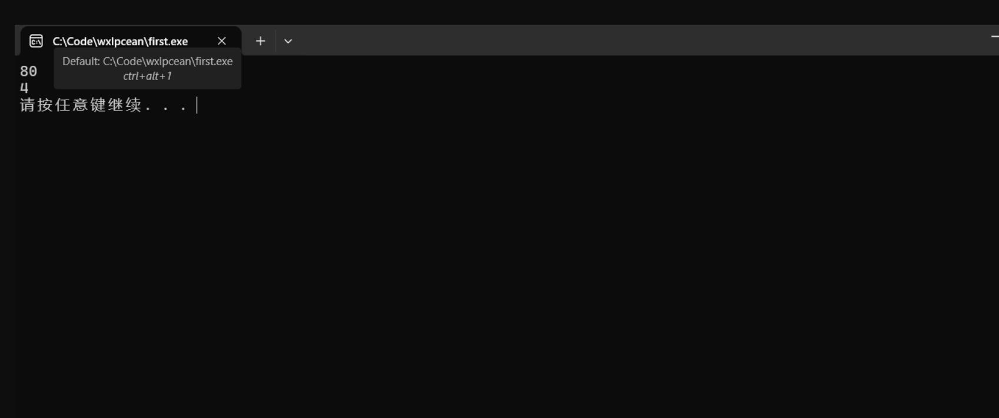
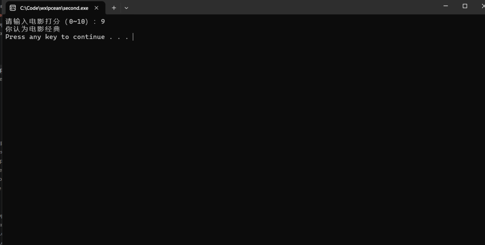
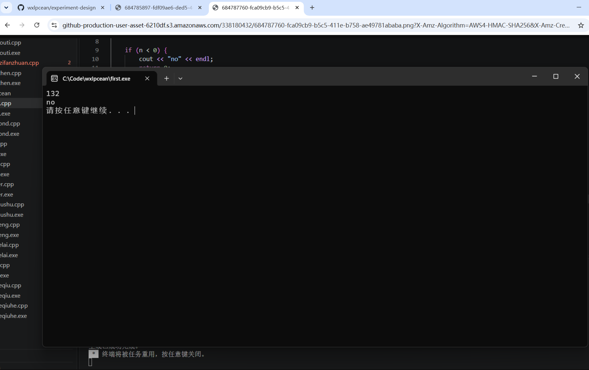
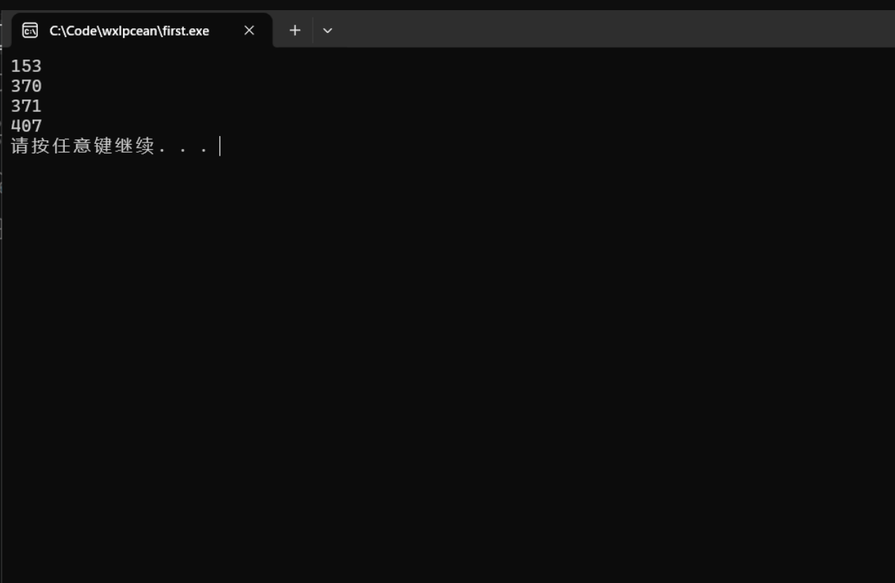
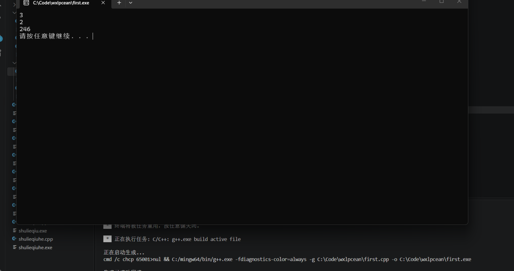
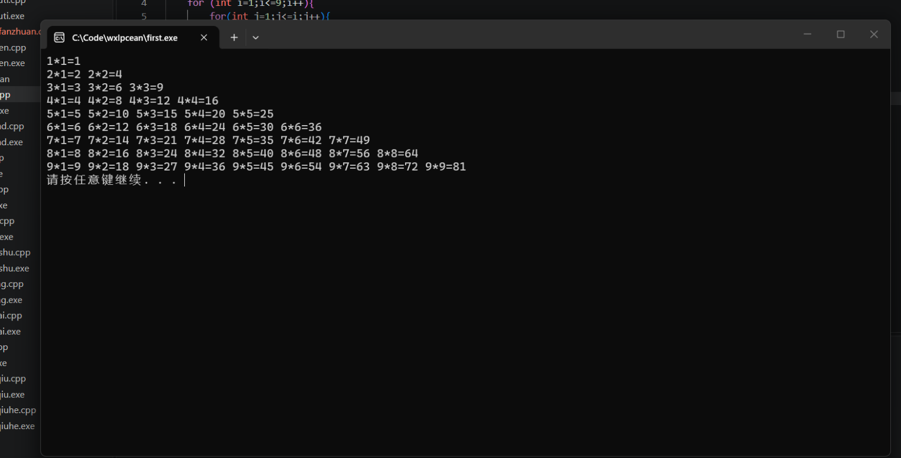
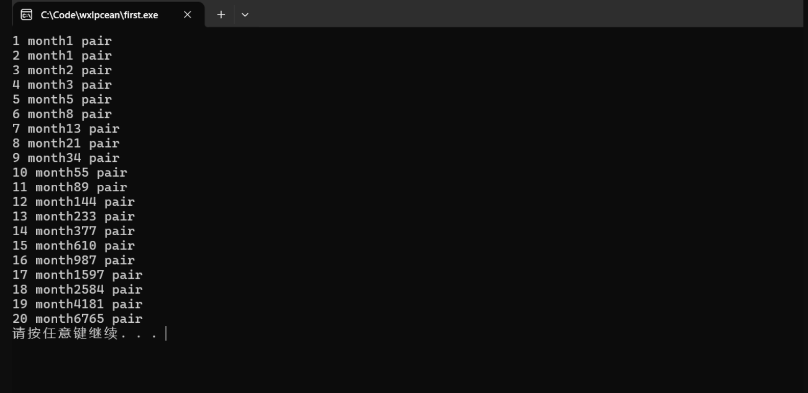
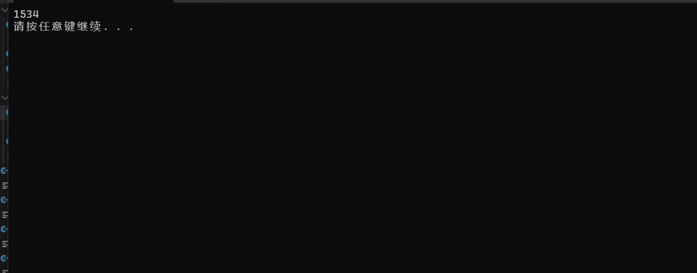

# 《高级语言程序设计(C++语言)》实验报告

| 项目 | 内容 | 项目 | 内容 |
| :--- | :--- | :--- | :--- |
| **实验名称** | 第一次上机课实验 | **实验日期** | 2026年10月23日 |
| **实验地点** | 于刚宋晓楼A237 | **学号** | 2026302192042 |
| **姓名** | 吴兴乐 | **学院** | 人工智能学院 |
| **专业** | 人工智能专业 | **指导老师** | 胡黔楠 |

---

## 一、实验目的
1. 掌握 C++ 的基本语法
2. 熟悉C++的分支，循环等基本语法

## 二、实验环境
- **操作系统**：Windows 11
- **开发工具**：Visual Studio Code
- **编程语言**：C++

## 三、实验过程及结果

### 题目1：企业奖金提成计算

**解答：代码**
```cpp
 #include<iostream>
using namespace std;
int main(){
int I,sum;
cin>>I;
if(I<=10){
   sum=I*0.1; 
}
else if(I>10&&I<20){
    sum=10*0.1+(I-10)*0.075;
}
else if ( I>=20){
    sum=10*0.1+10*0.075+(I-20)*0.05;
}
else if(I>20&&I<=40){
    sum= 10*0.1+10*0.075+(I-20)*0.05;
}
else if (I>40&&I<=60){
    sum=10*0.1+10*0.075+20*0.05+(I-40)*0.03;
}
else if(I>60&&I<=100){
    sum=10*0.1+10*0.075+20*0.05+20*0.03+(I-60)*0.015;
}
else {
    sum=10*0.1+10*0.075+20*0.05+20*0.03+40*0.015+(I-100)*0.01;
}
cout<<sum<<endl;
system("pause");
return 0;
}




### 题目2：电影打分评语

**解答：代码**
```cpp
#include <iostream>
#include <windows.h> 
using namespace std;

int main() {
  SetConsoleOutputCP(65001);
    int score;
    cout << "请输入电影打分（0~10）：";
    cin >> score;

    switch (score) {
        case 10:
        case 9:
            cout << "你认为电影经典" << endl;
            break;
        case 8:
        case 7:
            cout << "你认为电影非常好" << endl;
            break;
        case 6:
        case 5:
            cout << "你认为电影一般" << endl;
            break;
        case 4:
        case 3:
        case 2:
        case 1:
        case 0:
            cout << "你认为电影烂片" << endl;
            break;
        default:
            cout << "输入无效，请输入 0~10 的整数" << endl;
            break;
    }

    return 0;
}




### 题目3：判断回文数

**解答：代码**
```cpp
#include <iostream>
#include <string>
using namespace std;

int main() {
    int n;
    cin >> n;

    if (n < 0) {                       
        cout << "no" << endl;
        return 0;
    }

    string s = to_string(n);
    int len = s.length();
    bool shihuiwen= true;         

    for (int i = 0; i < len / 2; i++) {
        if (s[i] != s[len - i - 1]) {  
            shihuiwen = false;
            break;                     
        }
    }

    cout << (shihuiwen ? "yes" : "no") << endl;  
    return 0;
}




### 题目4：三位水仙花数

**解答：代码**
```cpp
#include<iostream>
using namespace std;
int main (){
    for (int i=100;i<=999;i++){
        int a=i/100;
        int b=i/10%10;
        int c=i%10;
        if (a*a*a+b*b*b+c*c*c==i){
            cout<<i<<endl;
        }
    }
system("pause");
return 0;
}




### 题目5：数列 a, aa, aaa... 求和

**解答：代码**
```cpp
#include <iostream>
using namespace std;

int main() {
    int n, a;
    cin >> n >> a;

    long long sum = 0;    
    long long term = 0;   

    for (int i = 1; i <= n; i++) {
        term = term * 10 + a;  
        sum += term;            
    }

    cout  << sum << endl;
    return 0;
}




### 题目6：乘法口诀表

**解答：代码**
```cpp
#include<iostream>
using namespace std;
int main(){
    for (int i=1;i<=9;i++){
        for(int j=1;j<=i;j++){
            int sum=i*j;
            cout<<i<<"*"<<j<<"="<<sum<<" ";
        }
        cout<<endl;
    }return 0;
}



### 题目7：兔子数量

**解答：代码**
```cpp
#include <iostream>
using namespace std;

int main() {
    long long a[21];   
    a[1] = 1;
    a[2] = 1;

    for (int n = 3; n <= 20; n++) {
        a[n] = a[n-1] + a[n-2];   
    }

   
    for (int n = 1; n <= 20; n++) {
        cout <<  n << "month" << a[n] << " pair" << endl;
    }

    return 0;
}




### 题目8：猴子吃桃

**解答：代码**
```cpp
#include<iostream>
using namespace std;
int main(){
    long long a=1;
    for(int i=1;i<=9;i++){
        a=(a+1)*2;
    }
    cout<<a<<endl;
system("pause")；
;    return 0;
}




实验总结：
边界要抠清楚：< 还是 <=、数组下标从 0 开始，这种小地方最容易错。
数字大了要用 long long：不然算着算着就溢出了。
代码写得有点乱，注释少，下次多写注释、变量名起清楚点。
可以试着把每道题包成函数，别全堆在 main 里。
兔子题其实不用数组也行，用两个变量滚动就能省空间，可以练练。


